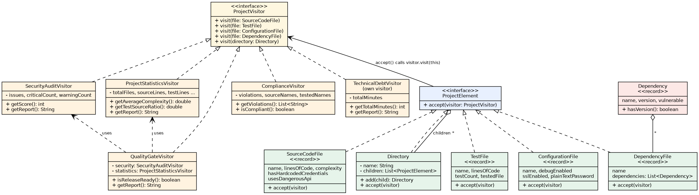
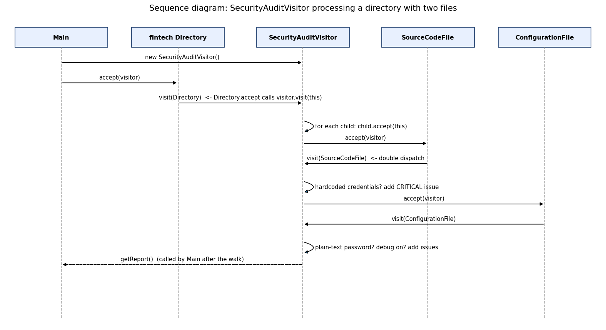

# Smart Code Inspection & Compliance Engine

Assignment 6 - Visitor Pattern (Java 17, Maven, JUnit 5)

This program inspects a software project. A project is made of different elements (source files, test files, config files, dependency files, directories). Many different checks must run on the same elements: security audit, statistics, quality gate, compliance and technical debt. Each check is a **visitor**, so the element classes stay small and never change when a new check is added.

## How to run

```bash
javac -d out src/inspection/*.java
java -cp out inspection.Main   
```

## Architecture

**Elements** (the things we inspect). Every element has `accept(ProjectVisitor visitor)`.

| Class               | Data                                                                            |
|---------------------|---------------------------------------------------------------------------------|
| `SourceCodeFile`    | name, lines of code, complexity, hardcoded credentials flag, dangerous API flag |
| `TestFile`          | name, lines of code, number of tests, name of the tested file                   |
| `ConfigurationFile` | name, debug enabled, SSL enabled, plain-text password                           |
| `DependencyFile`    | name, list of `Dependency` (name, version, vulnerable)                          |
| `Directory`         | name, list of children (files or other directories)                             |

**Visitors** (the operations). `ProjectVisitor` has one `visit` method for each element type.

| Class                      | What it does                                                                                             |
|----------------------------|----------------------------------------------------------------------------------------------------------|
| `SecurityAuditVisitor`     | finds hardcoded credentials, vulnerable dependencies, insecure config, high-risk files; gives a score    |
| `ProjectStatisticsVisitor` | counts files, lines, tests, dependencies; average complexity; test/source ratio                          |
| `QualityGateVisitor`       | PASS or FAIL for security, complexity and tests; final result                                            |
| `ComplianceVisitor`        | checks the company rules (no exposed credentials, versions set, tests exist, no prohibited dependencies) |
| `TechnicalDebtVisitor`     | my own visitor: estimates clean-up time (added in a separate commit)                                     |

`SampleProject` builds the `fintech-project` structure from the assignment, and `Main` runs every visitor on it.

### Rules and formulas

| Item               | Rule                                                                              |
|--------------------|-----------------------------------------------------------------------------------|
| Security score     | 100 - 25 per critical issue - 10 per warning (not below 0)                        |
| Critical           | hardcoded credentials, plain-text password, vulnerable dependency                 |
| Warning            | high-risk source file, debug enabled, SSL disabled                                |
| Average complexity | sum of complexity of source files / number of source files                        |
| Test/source ratio  | lines of test code / lines of source code                                         |
| Quality gate       | security: 0 critical issues; complexity: average <= 10; tests: ratio >= 0.40      |
| Technical debt     | (complexity - 10) x 30 min if complexity > 10, plus 60 min if more than 300 lines |

## UML

### Class diagram



### Sequence diagram



## Answers to the questions

**What problem does Visitor solve in your project?**
We have 5 element types and 5 operations. If every operation was a method inside every element, each element class would hold security, statistics and compliance code, and every new check would change all of them. With Visitor, each operation lives in its own class and the elements stay unchanged.

**Where are Element and Visitor?**
Element: `ProjectElement.java` and its classes `SourceCodeFile`, `TestFile`, `ConfigurationFile`, `DependencyFile` and `Directory`. Visitor: `ProjectVisitor.java` and its classes `SecurityAuditVisitor`, `ProjectStatisticsVisitor`, `QualityGateVisitor`, `ComplianceVisitor` and `TechnicalDebtVisitor`.

**What is double dispatch?**
The method that runs depends on two things: the type of the element and the type of the visitor. It happens in two steps. First, `element.accept(visitor)` runs the `accept` of the real element class (for example `SourceCodeFile`). Second, inside it, `visitor.visit(this)` is called. Here `this` has the exact type `SourceCodeFile`, so Java picks `visit(SourceCodeFile)` of the real visitor. We never use `instanceof` or a switch.

**Why not put all operations directly inside the Element classes?**
The element classes would grow with every new operation, they would mix data with unrelated logic (breaks SRP), and each change could break old code. Now the code of one operation is in one place and can be tested alone.

**Is it easier to add a new Visitor or a new Element? Why?**
A new Visitor is easier: write one class and no existing class changes (`TechnicalDebtVisitor` was added this way). A new Element is harder, because `ProjectVisitor` needs a new `visit` method and then every visitor must implement it.

**What happens if we add a new element called DatabaseMigrationFile?**
1. Create the new class `DatabaseMigrationFile` with `accept(...)` that calls `visitor.visit(this)`.
2. Add `void visit(DatabaseMigrationFile file);` to the `ProjectVisitor` interface.
3. Because of this, all 5 visitor classes stop compiling until each one gets a `visit(DatabaseMigrationFile)` method (it can be empty if the visitor does not care).
   The other element classes (`SourceCodeFile`, `TestFile`, `ConfigurationFile`, `DependencyFile`, `Directory`) do not change. This is the main limitation of Visitor: it is good when new operations are added often and the element types change rarely.

**When would Visitor be a bad choice?**
When new element types appear often, because every new type changes the interface and all visitors. It is also not needed when there are only one or two operations, or when the element types are not stable.

**How is Visitor different from Strategy?**
Strategy swaps one algorithm of one object (for example "how to pick a route") and the client chooses it. Visitor adds many operations over a whole structure of different element types, and the right `visit` method is chosen by the type of each element (double dispatch). Strategy hides different algorithms for the same task; Visitor separates the operations from a structure of different classes.

**Which SOLID principles can you identify?**
- **SRP:** every class has one job. Elements only hold data, each visitor does one check.
- **OCP:** new operations (visitors) are added without changing the elements. Adding `TechnicalDebtVisitor` changed no element class.
- **DIP:** elements depend on the `ProjectVisitor` interface, not on concrete visitors.
- **ISP / LSP (bonus):** every visitor can be used in place of the `ProjectVisitor` interface, so `Directory` works the same with any of them. Note that OCP only works for visitors; it breaks for new elements (see above).
## Example console output

```
SECURITY AUDIT
[CRITICAL] Hardcoded credentials in PaymentService.java
[WARNING] High-risk source file: UserService.java
[CRITICAL] Plain-text password in application.properties
[WARNING] Debug mode enabled in application.properties
[CRITICAL] Vulnerable dependency jackson-databind in pom.xml
Critical: 3, warnings: 2, security score: 5/100

PROJECT STATISTICS
Total files: 5 (source 2, test 1)
Lines of source code: 500
Lines of test code: 120
Number of tests: 8
Dependencies: 5
Average complexity: 9.0
Test/source ratio: 0.24

QUALITY GATE
Security: FAIL
Complexity: PASS
Tests: FAIL
FINAL RESULT: FAILED

COMPLIANCE CHECK
VIOLATION: Exposed credentials in PaymentService.java
VIOLATION: Exposed credentials in application.properties
VIOLATION: Prohibited dependency log4j in pom.xml
VIOLATION: Dependency gson has no version in pom.xml
VIOLATION: Production file UserService.java has no test
Result: 5 violation(s)
```

## Test results

There are 40 JUnit 5 tests. They cover all element types and double dispatch, the security visitor, statistics, quality gate PASS and FAIL, compliance violations, nested directories, an empty directory, a very deep directory (200 levels), the technical debt visitor and edge cases.

```
[        40 tests found           ]
[        40 tests successful      ]
[         0 tests failed          ]
```
